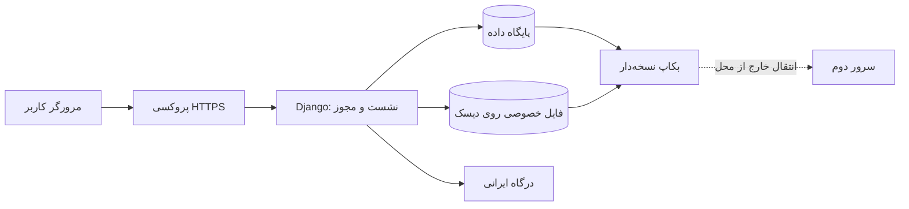

# معماری نسخه اولیه

## انتخاب ساختار

یک برنامه یکپارچه Django با صفحات فارسی سمت سرور، ورود مبتنی بر نشست و پنل مدیریت آماده استفاده می‌شود. سایت روی ویندوز یا لینوکس قابل اجراست و به سرویس میزبانی خاص وابسته نیست. SQLite برای شروع و اجرای یک سرور انتخاب شده است؛ چند سرور برنامه یا بار بالاتر به بررسی و مهاجرت PostgreSQL نیاز دارد.

برای انتخاب نسخه، [پشتیبانی Python در مستندات Django](https://docs.djangoproject.com/en/5.2/faq/install/) و [شاخه LTS](https://www.djangoproject.com/download/) بررسی شده است. وابستگی اصلی دقیقاً در requirements قفل شده است.

انتقال خودکار به سرور دوم در این نسخه پیکربندی نشده است. فضای فایل و پایگاه داده می‌توانند روی دیسک‌های جدا باشند. مقدار `PRIVATE_MEDIA_ROOT` محل فایل‌ها را مشخص می‌کند. مسیر آن نباید با وب‌سرور عمومی سرو شود.

## مدل داده

| مدل | مسئولیت |
| --- | --- |
| User / Session | هویت، رمز هش‌شده، ورود و مدیریت نشست |
| Profile | یک رزومه برای هر حساب؛ شناسه UUID و وضعیت انتشار |
| WorkLink | عنوان و لینک HTTP/HTTPS اثر متعلق به رزومه |
| PortfolioFile | مالک، نام دیسکی تصادفی، اندازه واقعی و نوع فایل |
| SiteSettings | یک ردیف تنظیمات؛ سهمیه رایگان پیش‌فرض ۱۰۰ MB |
| Plan | نوع مشاهده یا فضا، قیمت ریالی و مدت |
| Entitlement | مجوز دارای شروع و پایان، لغو و مرجع فعال‌سازی |
| Payment | سفارش و مشخصات ثابت خرید، شناسه درگاه و رسید |
| Favorite | جفت یکتای حساب انتخاب‌کننده و رزومه |

## کنترل دسترسی

کنترل در سمت سرور است. صفحه خود کاربر مجاز است؛ برای رزومه دیگران، هم انتشار رزومه و هم اشتراک مشاهده معتبر لازم است. همین قاعده روی فایل اعمال می‌شود. حساب مدیر در مسیرهای عادی دورزننده این قانون نیست؛ مدیریت با مجوزهای پنل Django انجام می‌شود.

صفحات خصوصی و فایل‌ها `no-store` هستند. فایل‌ها از مسیر وابسته به مجوز با `FileResponse` یا پاسخ محدود به byte range ارسال می‌شوند؛ ویدئو قابلیت دریافت محدوده بایت دارد. هیچ مسیر عمومی `/media/` وجود ندارد.

## بارگذاری

پردازش جریان بارگذاری قبل از ذخیره موقت، سقف فنی درخواست را اعمال می‌کند. فرم پسوند و امضای ابتدایی JPG، PNG، WebP، MP4 و WebM را بررسی می‌کند و به نوع اعلام‌شده از مرورگر اعتماد نمی‌کند. این بررسی جای اعتبارسنجی کامل فایل، اسکن یا تبدیل ویدئو را نمی‌گیرد؛ آن‌ها در نقشه راه هستند.

پیش از بررسی مجموع مصرف، یک عملیات نوشتن روی ردیف پروفایل قفل نویسنده SQLite را می‌گیرد. محاسبه سهمیه، ثبت فایل و ثبت رکورد در تراکنش انجام می‌شود تا دو درخواست هم‌زمان از سهمیه عبور نکنند. خطای ثبت پایگاه داده، فایل تازه ذخیره‌شده را پاک می‌کند. حذف رکورد، حذف فایل را به پس از ثبت موفق تراکنش موکول می‌کند.

خاموشی ناگهانی میان نوشتن فایل و ثبت تراکنش ممکن است فایل بدون رکورد باقی بگذارد؛ ابزار تطبیق و پاک‌سازی کنترل‌شده باید پیش از بهره‌برداری بزرگ اضافه شود. رقابت دو بارگذاری برای سهمیه یک حساب در آزمون مستقل بررسی می‌شود؛ این جای آزمون فشار و سنجش ظرفیت را نمی‌گیرد.

## پرداخت

آداپتور زرین‌پال از منطق ایجاد اشتراک جداست. همه مقادیر خرید در سرور ثبت می‌شوند و تأیید با همان مبلغ و شناسه درگاه انجام می‌شود. پس از تأیید، قفل حساب و محدودیت یکتایی رسید، مانع ساخت اشتراک تکراری می‌شوند. کلید پذیرندگی در محیط است و پاسخ کامل درگاه یا داده کارت ذخیره نمی‌شود.

اشتراک‌های sandbox با نشان آزمایشی ذخیره می‌شوند و در حالت پرداخت واقعی معتبر نیستند. با این حال محیط آزمایش و تولید باید پایگاه داده و فضای فایل جدا داشته باشند.

## محدودیت فعلی

تبدیل ویدئو، کیفیت تطبیقی، CDN، صف پردازش، PostgreSQL، همگام‌سازی زنده، failover خودکار و مانیتورینگ زیرساخت پیاده‌سازی نشده‌اند. نسخه اول ویدئوی اصلی را با قابلیت range ارائه می‌دهد. سرور دوم و بکاپ خارج از محل باید با تجهیزات واقعی راه‌اندازی و آزمایش شوند.
